<p align="center">
  <a href="https://ruvelo.github.io/wp-editorial/">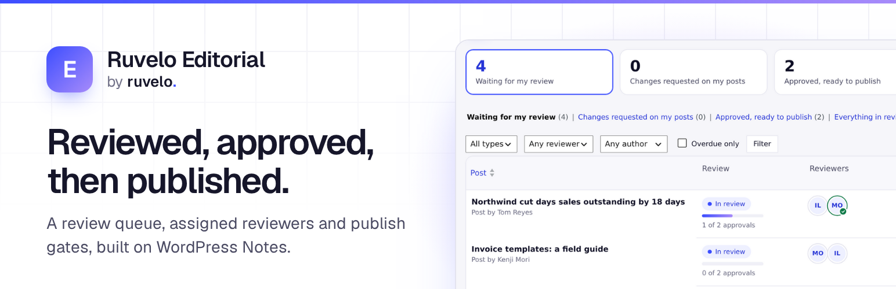</a>
</p>

<p align="center">
  <a href="https://playground.wordpress.net/?blueprint-url=https://raw.githubusercontent.com/Ruvelo/wp-editorial/main/blueprint.json"><strong>Try it in Playground</strong></a> &nbsp;&nbsp;&nbsp;
  <a href="https://ruvelo.github.io/wp-editorial/"><strong>Website</strong></a> &nbsp;&nbsp;&nbsp;
  <a href="#for-developers"><strong>Developer guide</strong></a> &nbsp;&nbsp;&nbsp;
  <a href="CHANGELOG.md"><strong>Changelog</strong></a>
</p>

<p align="center">
  <a href="https://github.com/Ruvelo/wp-editorial/actions/workflows/tests.yml"></a>
  
  
  
  
  <a href="LICENSE"></a>
</p>

# Ruvelo Editorial

**Review and approval for WordPress, built on core Notes.** WordPress gave your team Notes: comments on any block of a draft. Ruvelo Editorial adds the decision around them: who should review this post, have they, and can it go out. A review queue, assigned reviewers, "approved" and "changes requested", and optional gates that hold publishing until a post is approved. It extends what core does and replaces nothing: notes stay core notes, statuses stay core statuses.

```
wp plugin install https://github.com/Ruvelo/wp-editorial/releases/latest/download/ruvelo-editorial.zip --activate
```

Reviews are on for posts and pages straight away: open a draft and use the **Review** panel. Or look around [Halyard's marketing team in WordPress Playground](https://playground.wordpress.net/?blueprint-url=https://raw.githubusercontent.com/Ruvelo/wp-editorial/main/blueprint.json) first, signed in as their managing editor.

## A quick tour

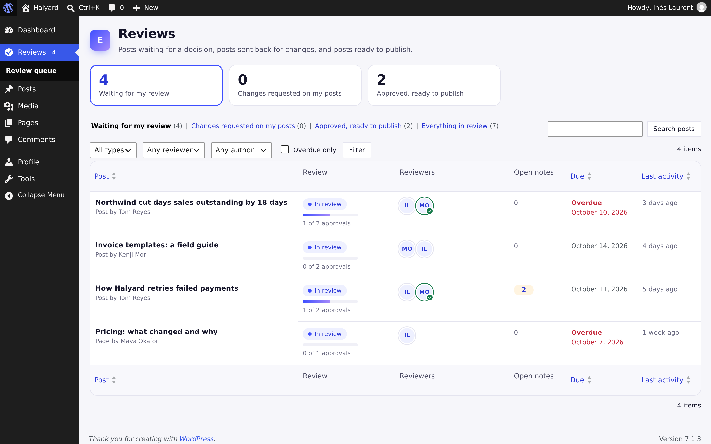

**A queue for everyone.** What's waiting for your review, the changes requested on your posts, and what's approved and ready to go out, with approvals, reviewers, open notes, due dates and filters. The Reviews menu shows how many posts wait for you.

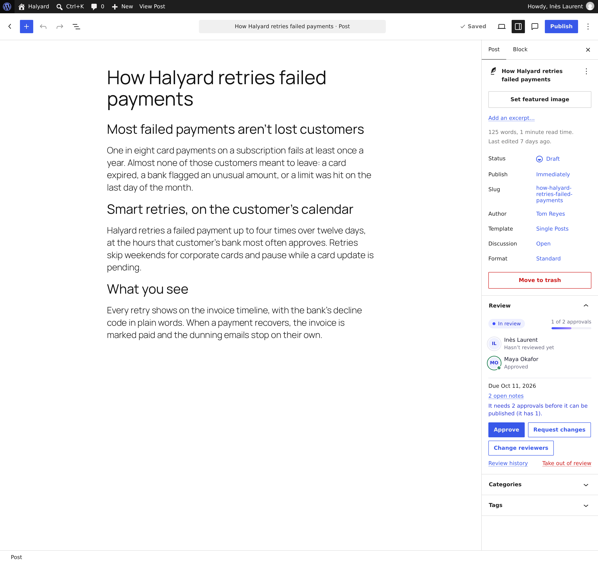

**Decide where you read.** The Review panel in the editor shows the state, each reviewer's decision, approvals so far and needed, open notes (one click opens core's Notes sidebar), and what you can do next.

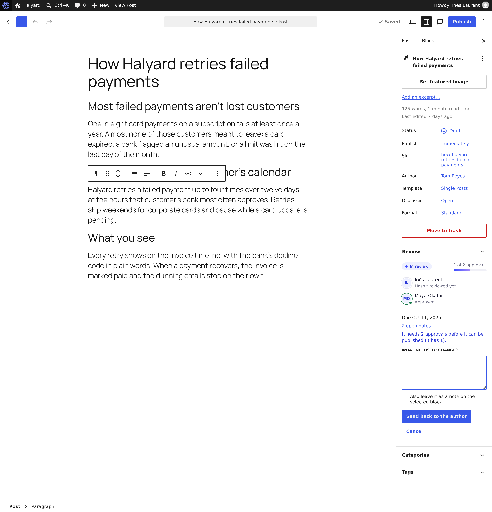

**Change requests that land where they belong.** A message can also become a core note on the block it's about, so the author finds it in the Notes sidebar like any other note.

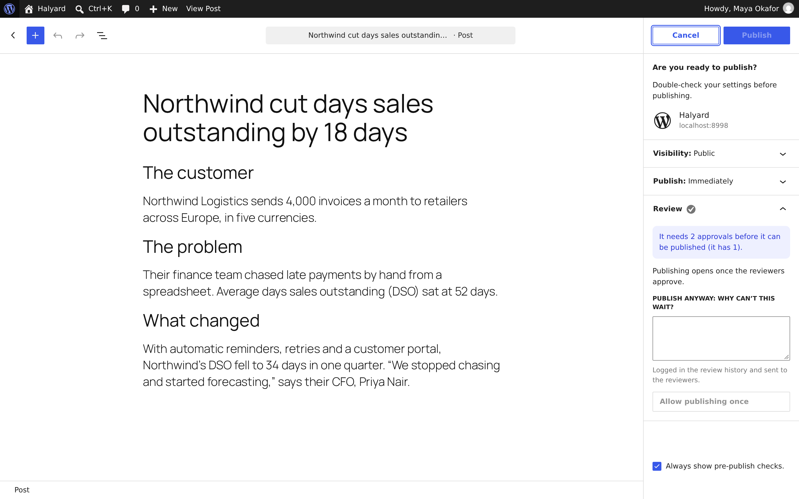

**Optional publish gates.** Per post type: hold publishing and scheduling until a post has its approvals, and optionally until its notes are resolved. The editor holds the button and says why; the server enforces it everywhere else. Administrators can publish anyway, with a reason that's logged and sent to the reviewers.

<table>
  <tr>
    <td width="50%">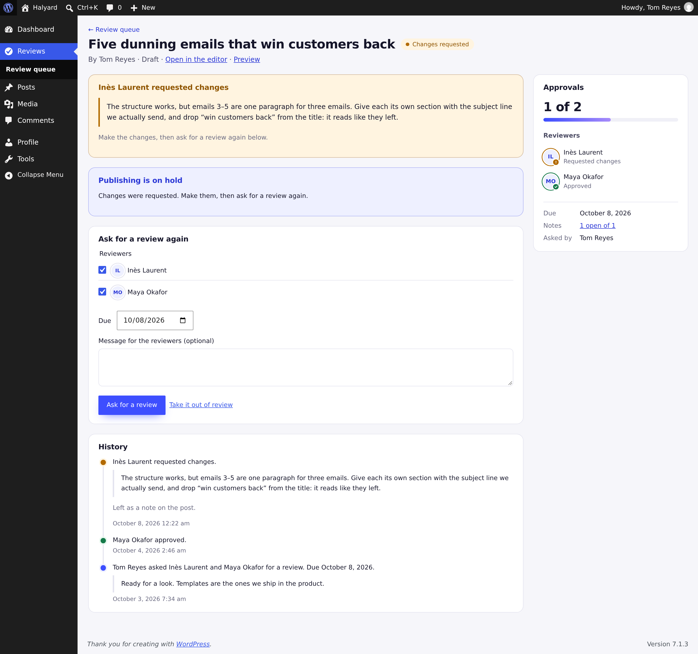</td>
    <td width="50%">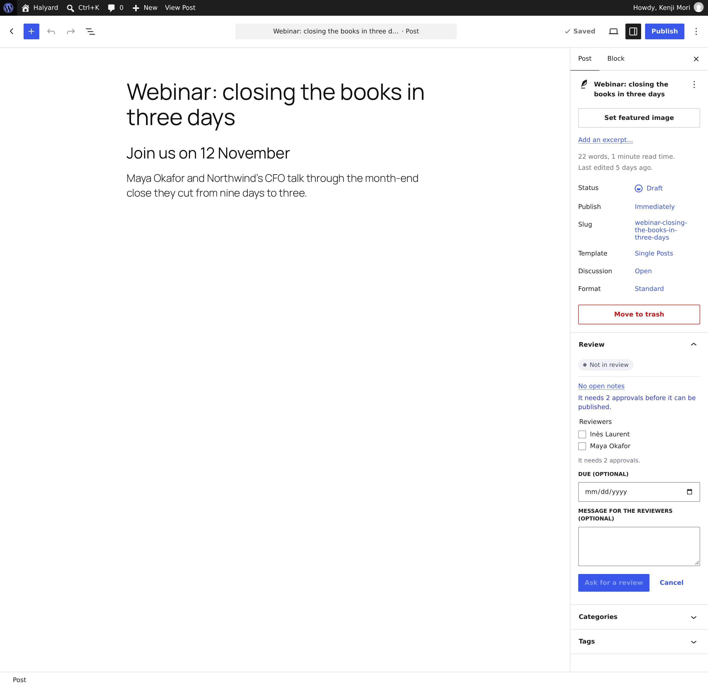</td>
  </tr>
  <tr>
    <td><strong>Every post's history</strong>, and every action as a plain form that works without JavaScript.</td>
    <td><strong>Ask for a review</strong> with reviewers, a due date and a message.</td>
  </tr>
  <tr>
    <td width="50%">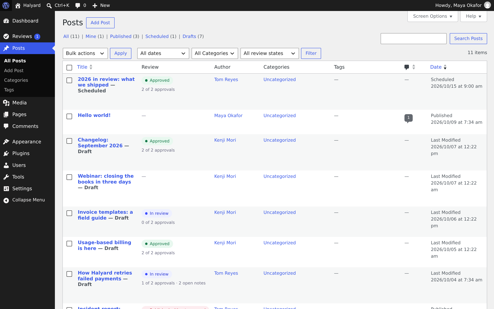</td>
    <td width="50%">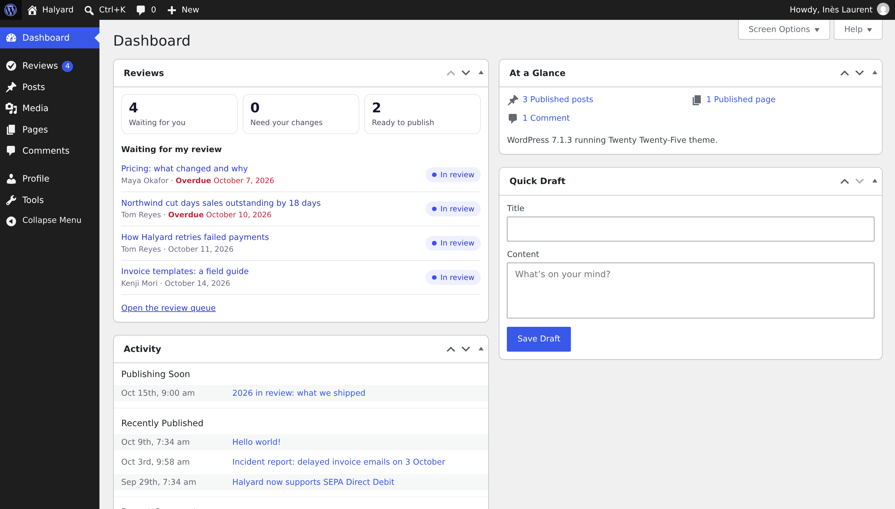</td>
  </tr>
  <tr>
    <td><strong>A Review column</strong> and filter on every reviewed post type.</td>
    <td><strong>A dashboard widget</strong>: what's next for you.</td>
  </tr>
  <tr>
    <td width="50%">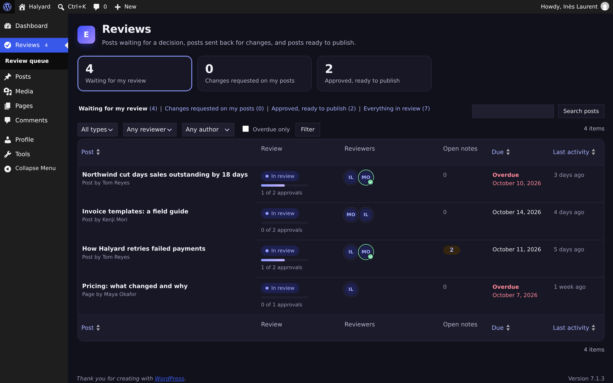</td>
    <td width="50%">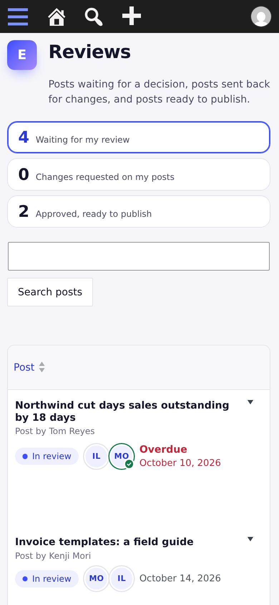</td>
  </tr>
  <tr>
    <td><strong>Light, dark</strong> or your device's setting, per person.</td>
    <td><strong>Mobile first</strong>, down to 360px.</td>
  </tr>
</table>

## Features

- **Review states** per post, on any post type you choose: Not in review → In review → Changes requested → Approved, then scheduled or published by core. Stored as post meta beside the post status, never instead of it.
- **Reviewers and rounds**: ask one or more reviewers (anyone with `ruvelo_review_posts` who can edit the post), with an optional due date and message. Change reviewers mid-review without losing approvals. After changes are requested, asking again starts a new round.
- **Approvals**: one or more per post type. A post is Approved once it has enough; every approval is recorded.
- **Change requests** with a message that can become a core note anchored to a block, or point to an existing note.
- **Publish gates** (optional, per post type): no first publish or schedule without the approvals, and optionally no open notes. Enforced in the editor, the REST API, the classic editor, quick and bulk edit, XML-RPC and WP-CLI. Overrides need `ruvelo_override_review_gate` and a reason, and are logged.
- **History** of every request, approval, change request, withdrawal, publish and override, with who, when and what they said.
- **Review queue** (a list table with views, filters, search, sorting and paging), a **review screen** per post, a **Review column** and state filter on post lists, a **dashboard widget**, and a count in the menu.
- **Editor panel** in plain JavaScript on WordPress's own components: no build step, keyboard accessible, with a pre-publish check.
- **Notifications**: grouped emails through WP-Cron, per-person opt-out, Ruvelo Inbox delivery, and an action for any other channel.
- **Developer API**: REST, WP-CLI, Abilities API, actions on every transition, filters for gates, reviewers and approvals, and settings in code.
- **Privacy**: personal data export and erasure for review decisions. No remote requests, no Gravatars.

## Our promises

- **No nags, no upsells, no "pro" version.** No admin notices outside the plugin's own screens, no review requests, no ads, no redirect on activation.
- **No tracking and no remote requests.** Nothing phones home; no fonts, scripts, images, banners or Gravatars are loaded from anywhere else. The only emails sent are the ones you turn on.
- **Updates only from WordPress.org and Composer**, through WordPress's own updater. Ruvelo will never sell this plugin, its WordPress.org account or its users.
- **A clean uninstall.** The email queue, its scheduled event and the capabilities are always removed. Review states and history stay unless you tick "also delete review states, history and settings". Core notes are never deleted.
- **Accessible**: aiming at WCAG 2.2 AA, every action available without JavaScript, respecting reduced motion and dark mode.

## Requirements

- WordPress 7.0 or later (tested up to 7.1)
- PHP 8.2 or later
- MySQL or MariaDB, or SQLite through the official integration plugin

## Getting started

**1. Install** by uploading [ruvelo-editorial.zip](https://github.com/Ruvelo/wp-editorial/releases/latest/download/ruvelo-editorial.zip) in Plugins → Add New → Upload Plugin, with WP-CLI as above, or with Composer (`composer require ruvelo/wp-editorial`, installed by `composer/installers` as a WordPress plugin).

**2. Ask for a review.** Open a draft, find the **Review** panel in the document sidebar, pick reviewers and a due date. They get an email a few minutes later and see the post in Reviews → Review queue.

**3. Decide whether publishing waits.** Reviews → Settings, per post type: reviews on or off, **Hold publishing until approved**, how many approvals, and whether open notes must be resolved first.

## Who can do what

| Capability | Default | |
|---|---|---|
| `edit_post` (core) | Authors on their posts, editors on all | Ask for a review, change reviewers, take a post out of review |
| `ruvelo_review_posts` | Administrators, editors | Be a reviewer: approve or request changes on posts you're assigned and can edit. Filter `ruvelo_editorial_reviewer_roles` before activation, or grant it to any role |
| `ruvelo_override_review_gate` | Administrators | Publish past a gate with a logged reason (`ruvelo_editorial_override_roles`) |
| `ruvelo_manage_editorial` | Administrators | Change settings (`ruvelo_editorial_manager_roles`) |

## For developers

### Built on core Notes

What WordPress 7.0 and 7.1 actually store, read from the core source, and how the plugin uses it:

| Core | How it works | The plugin |
|---|---|---|
| A note | A comment with `comment_type = 'note'` on the post; replies set `comment_parent`. Created over REST (`POST /wp/v2/comments`, `type: note`) by the editor | Counts top-level notes per post in one grouped query; starts a thread with `wp_insert_comment()` the same way |
| Open or resolved | The thread's top-level note is held (`comment_approved = '0'`) while open and approved (`'1'`) once resolved. The resolve or reopen action is an empty reply carrying `_wp_note_status` (`resolved` / `reopen`, registered comment meta) | Open notes = held top-level notes; "must be resolved" gates check exactly that |
| Anchoring | A block's `metadata.noteId` attribute: one id in 7.0, a list in 7.1. 7.1 also anchors inline with `<mark class="wp-note" data-id>` and strips it on render | Anchors a new thread to the first block without a note (on 7.1, to the first block when all have one); in the editor, to the selected block |
| Support | `post_type_supports($type, 'editor')` with `['notes' => true]` (posts and pages have it) | Turns it on for custom post types you review (`ruvelo_editorial_enable_notes`) |
| Notifications | The post author is emailed for every note (`wp_notes_notify`); 7.1 adds @mentions (`wp-note-mention user-N` chips, `wp_notify_note_mentions` on `rest_insert_comment`) | Leaves both alone. Its own review emails are separate and grouped |
| Suggestions | Not in the 7.0.4 or 7.1.3 source: no suggestion comment type, meta or editor UI | Nothing to integrate yet. If core adds a comment type, `ruvelo_editorial_note_types` can count it as notes |

Notes created by the plugin skip core's REST-only hooks, so the author isn't emailed twice (the review email covers it).

### Data

| What | Where |
|---|---|
| Review state | Post meta `_ruvelo_editorial_state` (`draft`, `in_review`, `changes_requested`, `approved`) |
| People | Post meta, one row per person: `_ruvelo_editorial_reviewer`, `_pending`, `_approved_by`, `_changes_by`; `_requested_by` |
| Round, due date, last activity | `_ruvelo_editorial_round`, `_ruvelo_editorial_due` (Y-m-d), `_ruvelo_editorial_updated` |
| History | Post meta `_ruvelo_editorial_event`, one row per event: `type`, `user`, `at`, `note`, `from`, `to`, `round`, `reviewers`, `note_id`, `due` |
| A pending override | Post meta `_ruvelo_editorial_override` (user, reason, time; valid for an hour, used once) |
| Email queue | Table `{prefix}ruvelo_editorial_outbox`, one row per person per event until WP-Cron sends their digest |
| Settings | Option `ruvelo_editorial_settings` (filter `ruvelo_editorial_settings` to define them in code) |

Also in core REST: a read-only `ruvelo_review` field (edit context) on every reviewed post type.

### PHP API

`Ruvelo\WP\Editorial\Review` is the one write path. The editor panel, the review screen, REST, WP-CLI and abilities all call it, so the history, hooks and notifications are always right. Each method checks the actor's permissions and returns `true` or a `WP_Error` with an HTTP status.

```php
use Ruvelo\WP\Editorial\Gate;
use Ruvelo\WP\Editorial\Review;

Review::request($post_id, [$ines_id, $maya_id], $author_id, 'Mostly the numbers.', '2026-10-14');
Review::approve($post_id, $ines_id, 'Good to go.');
Review::requestChanges($post_id, $maya_id, 'Split the last section.', note_id: 0, createNote: true);
Review::withdraw($post_id, $author_id);

Review::state($post_id);                      // 'in_review'
Review::summary(get_post($post_id), $user_id); // everything the panel shows
Gate::check(get_post($post_id), $user_id);     // true, or WP_Error with the reasons
Gate::allowOnce($post_id, $admin_id, 'Incident update; reviewed on a call.');
```

### Actions

| Action | Arguments | When |
|---|---|---|
| `ruvelo_editorial_transition` | `$post_id, $from, $to, $event` | After every review event |
| `ruvelo_editorial_requested` | `$post_id, $event` | A review was asked for (or asked again) |
| `ruvelo_editorial_reviewers_changed` | `$post_id, $event` | Reviewers changed while in review |
| `ruvelo_editorial_approved` | `$post_id, $event` | One reviewer approved |
| `ruvelo_editorial_fully_approved` | `$post_id, $event` | The post has all the approvals it needs |
| `ruvelo_editorial_changes_requested` | `$post_id, $event` | A reviewer sent it back |
| `ruvelo_editorial_withdrawn` | `$post_id, $event` | Taken out of review |
| `ruvelo_editorial_publish_blocked` | `$post_id, $error` | The gate held back a publish or schedule |
| `ruvelo_editorial_gate_overridden` | `$post_id, $event` | Published past the gate with a reason |
| `ruvelo_editorial_published_unapproved` | `$post_id, $event` | A gated post went out without approval (a filter or `wp_publish_post()`) |
| `ruvelo_editorial_note_created` | `$note_id, $post_id, $user_id` | The plugin started a core note thread |
| `ruvelo_editorial_notification` | `$user_ids, $event, $post_id, $actor, $message` | Every notification, before email and inbox delivery |
| `ruvelo_inbox_notify` | `$user_ids, $message` | Fired only when something listens (Ruvelo Inbox): `title`, `body`, `url`, `icon`, `actor`, `type`, `source`, `object_id` |
| `ruvelo_editorial_email_sent` | `$user_id, $sent, $items` | After each digest email |

### Filters

| Filter | Default | |
|---|---|---|
| `ruvelo_editorial_settings` | Saved settings | Define settings in code |
| `ruvelo_editorial_gate_passes` | Approved (and notes resolved, if required) | `($passes, $post, $user_id, $reasons)`: let a publish through, or hold it |
| `ruvelo_editorial_required_approvals` | From the post type's settings | `($approvals, $post)` |
| `ruvelo_editorial_reviewers` | People with the capability who can edit the post | `($users, $post, $post_type)` |
| `ruvelo_editorial_can_review` | Capability, edit access, not the author | `($can, $user_id, $post)` |
| `ruvelo_editorial_allow_self_review` | `false` | `($allow, $post)` |
| `ruvelo_editorial_states` | Four states | Labels and tones (`accent`, `success`, `warning`, `danger`, `neutral`); keys can't change |
| `ruvelo_editorial_note_types` | `['note']` | Comment types counted as notes |
| `ruvelo_editorial_enable_notes` | `true` | Turn core Notes on for reviewed custom post types |
| `ruvelo_editorial_queue_args` | | `($args, $view, $user_id, $filters)`: a queue view's `WP_Query` arguments |
| `ruvelo_editorial_email` | | `($email, $user, $items)`: change or cancel a digest |
| `ruvelo_editorial_inbox_message` | | `($message, $event, $post_id)` |
| `ruvelo_editorial_reviewer_roles`, `_override_roles`, `_manager_roles` | editor + administrator, administrator, administrator | Roles given each capability on activation |
| `ruvelo_editorial_uninstall_delete_data` | The setting | Decide in code whether uninstalling deletes review data |

### REST API

Namespace `ruvelo-editorial/v1`. Every route needs a signed-in user (cookie with the `wp_rest` nonce, or an application password).

| Request | Who | Does |
|---|---|---|
| `GET /posts/{id}` | Can edit the post | The review: state, reviewers and decisions, approvals, notes, due, gate, what you can do, history |
| `GET /posts/{id}/history` | Can edit the post | The history, oldest first, with a sentence for each event |
| `POST /posts/{id}/request` | Can edit the post | `{reviewers: [ids], due?, message?}` |
| `POST /posts/{id}/approve` | Assigned reviewer | `{message?, note_id?, create_note?}` |
| `POST /posts/{id}/request-changes` | Assigned reviewer | `{message?, note_id?, create_note?}` |
| `POST /posts/{id}/withdraw` | Can edit the post | `{message?}` |
| `POST /posts/{id}/override` | `ruvelo_override_review_gate` | `{reason}`: allow your next publish of this post, within the hour |
| `GET /queue?view=&post_type=&author=&reviewer=&overdue=&search=&orderby=&order=&page=&per_page=` | `edit_posts` | A queue view (`X-WP-Total`, `X-WP-TotalPages`) |
| `GET /counts` | `edit_posts` | `mine`, `changes`, `approved`, `all` |
| `GET /reviewers?post=` | `edit_posts` | Who can review that post |

Errors: `401` signed out, `403` not allowed (also the gate: `ruvelo_editorial_gate`), `404` unknown post, `400` invalid input, `409` not in a state that allows it.

### WP-CLI

Actions run as the WP-CLI user, so pass the global `--user` flag.

| Command | |
|---|---|
| `wp ruvelo-editorial request <post> --reviewers=<logins> [--due=] [--message=] --user=<author>` | Ask for a review, or change reviewers |
| `wp ruvelo-editorial approve <post> [--message=] --user=<reviewer>` | Approve |
| `wp ruvelo-editorial request-changes <post> [--message=] [--note] --user=<reviewer>` | Request changes, optionally as a core note |
| `wp ruvelo-editorial withdraw <post> --user=<author>` | Take out of review |
| `wp ruvelo-editorial status <post> [--format=]` | State, approvals, reviewers, due, open notes, gate |
| `wp ruvelo-editorial history <post> [--format=]` | The history |
| `wp ruvelo-editorial queue [--view=mine\|changes\|approved\|all] [--post_type=] [--overdue] [--format=] --user=<user>` | A queue view |
| `wp ruvelo-editorial notify` | Send waiting emails now |
| `wp ruvelo-editorial demo --yes` | Seed Halyard's demo team and posts |

`wp post update 42 --post_status=publish` goes through the gate too: without `--user`, nobody can approve or override, so a gated post stays a draft.

### Abilities (AI agents)

Registered with the WordPress Abilities API in the `ruvelo-editorial` category, with both `meta.public` (7.1) and `meta.show_in_rest` (what 7.0 reads), so they're listed in REST and offered to the MCP adapter when it's installed:

| Ability | Permission |
|---|---|
| `ruvelo-editorial/get-review-state` | Can edit the post (read-only) |
| `ruvelo-editorial/get-queue` | `edit_posts` (read-only) |
| `ruvelo-editorial/request-review` | Can edit the post |
| `ruvelo-editorial/approve` | `ruvelo_review_posts` and assigned to the post |
| `ruvelo-editorial/request-changes` | `ruvelo_review_posts` and assigned to the post |

### A note on DataViews

WordPress 7.0 rebuilt some screens on DataViews, and 7.1 added `GET /wp/v2/view-config` with the `get_entity_view_config_{kind}_{name}` filter. In 7.1 that configuration is read by core's own screens, and the DataViews package isn't exposed to plugins as a script handle: a plugin page would have to bundle React and the package with a build step. So the review queue is a standard list table (views, filters, sorting, paging, responsive) and will move to DataViews when core opens it to plugins.

## Contributing

Pull requests are welcome. Clone, `composer install`, `bin/dev-site.sh` for a local SQLite site with the demo, then `composer check` runs code style (Pint), the WordPress sniffs (PHPCS), static analysis (PHPStan level 8) and the tests, exactly as CI does. See [CONTRIBUTING.md](CONTRIBUTING.md).

## Credits

Built by [François Bultez](https://github.com/francoisbultez) at [Valtry](https://valtry.co.uk/?utm_source=ruvelo&utm_medium=github&utm_campaign=wp-editorial), the website security scanner, and everyone who [contributes](https://github.com/Ruvelo/wp-editorial/graphs/contributors).

## License

GPL-2.0-or-later. See [LICENSE](LICENSE).
